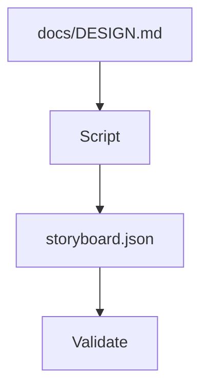
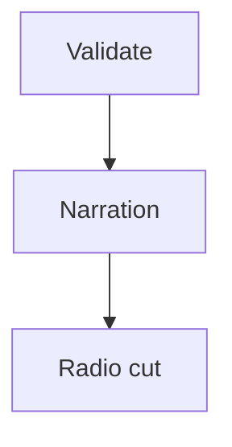
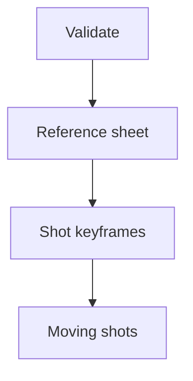
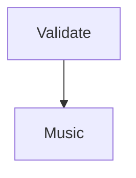
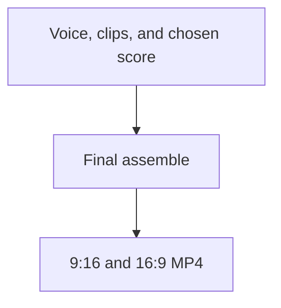
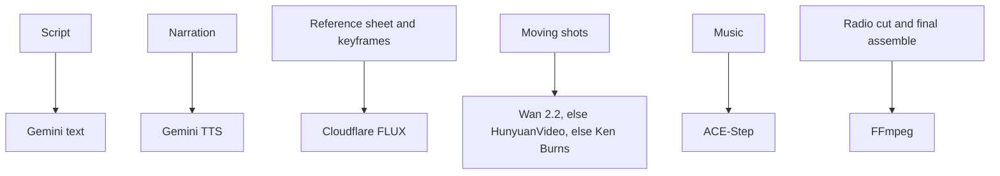
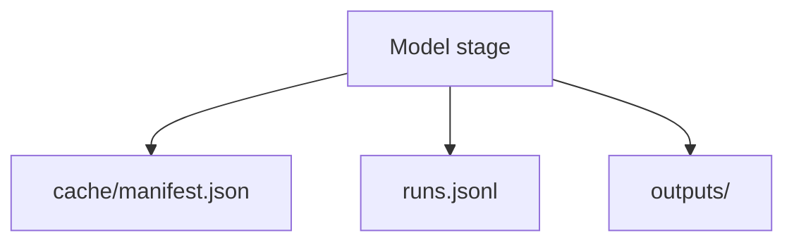

# Architecture

`make film` reads `storyboard.json` and runs the generation stages. The stages do not call each other. Each one reads the storyboard and the cache, writes its own files under `outputs/`, and appends one line per model call to `runs.jsonl`.

Script is the stage before that contract exists. It asks Gemini to draft `storyboard.json` from `docs/DESIGN.md`. The file on disk is the authority only after you approve it. Script does not call an image, video, or audio model.

After validation, three tracks are independent. Narration produces the radio cut. Keyframes start with a reference sheet, then one still per shot, then moving shots. Music generates score candidates. The final assemble waits until the voice, the clips, and the chosen score all exist.

The diagrams stay in a single column so a narrow preview can show them.

### How a run starts

### Track A, before any pictures

The radio cut is narration over placeholder music on a black screen. It is the Phase 1 checkpoint. At least three people from the audience hear it, and their notes go into `docs/DESIGN.md`, before a keyframe is generated.

### Track B, pictures

The reference sheet is a character view, an expression, and one golden frame. You pick the golden frame. Every shot keyframe is conditioned on it. A still with a bad face or bad hands is not sent to video.

### Track C, music

Music does not wait for pictures. The radio cut uses a temp track. Final assembly uses the ACE-Step candidate you chose.

### Final join

### Which model each stage calls

### Files every model stage writes

Moving shots wait until that shot has an accepted keyframe. Wan drafts at 480p. A 720p render is a later pass, and only for a shot you mark finished.

## Contracts

`storyboard.json` is the only creative input. Prompts and seeds live there, not in code. `schema/storyboard.schema.json` validates the file before every run.

Global fields: logline, narration language, audience, intent, style block, fictional characters, reference image ids, voice name and style, music cue, mix settings, and the end card. `ethics.likeness` is `fictional`. `ethics.real_people` is empty because no real face or voice appears.

Each shot has a stable id, a beat (`diversion`, `silence`, `turn`, or `light`), a one-sentence reason, a duration, narration text, an English subtitle, an image prompt and seed, reference ids, and a motion block. Motion mode is `i2v` or `kenburns`. The motion prompt describes camera and movement only. The keyframe client prepends the shared style block and character description so a shot prompt cannot re-describe the person.

The end card is not a shot. Assembly appends "Made with AI" for about 2.5 seconds. The film including that card is 60–90 seconds, in 9:16 and 16:9.

| Stage | Reads | Writes |
| --- | --- | --- |
| Script | `docs/DESIGN.md` and the schema | A draft `storyboard.json` for you to approve |
| Validate | `storyboard.json` and the schema | A pass, or a hard stop with no model calls |
| Narration | Each shot's line, language, voice, and style | `outputs/narration/<shot-id>.wav` |
| Reference sheet | Style block, character description, seeds | `outputs/references/` and the golden id in the storyboard |
| Keyframes | Style block, character description, golden reference, shot prompt, seed | `outputs/keyframes/<shot-id>.png` |
| Moving shots | Accepted still, motion prompt, seed, mode, draft resolution | `outputs/shots/<shot-id>.mp4` |
| Music | Cue caption, instrumental flag, tempo, key, duration, seeds | `outputs/music/` candidates and the chosen id in the storyboard |
| Radio cut | Narration wavs and a placeholder score | `outputs/radio/radio-cut.mp4` |
| Assemble | Wavs, clips, chosen score, subtitle text, durations, mix settings | `outputs/final/film-9x16.mp4`, `film-16x9.mp4`, and an SRT |

Editing one shot's narration line or image prompt changes only that shot. Downstream files for that shot are regenerated. Every other shot is reused.

Secrets stay in `.env`: `GEMINI_API_KEY`, `CLOUDFLARE_WORKERS_AI_API_TOKEN`, and `CLOUDFLARE_ACCOUNT_ID`. Kaggle uses the browser session. `runs.jsonl` stores model ids and parameters, never keys.

## Caching

`cache/manifest.json` maps `stage/shot_id` to the hash of the fields that stage reads, plus the model, seed, and output path.

| Stage | Hash includes | Left untouched when this changes |
| --- | --- | --- |
| Narration | Line, language, voice, style | Pictures and music |
| Reference sheet | Style block, character text, seed | Narration and music |
| Keyframes | Style block, character text, golden reference file, shot prompt, seed | Narration and music |
| Moving shots | Keyframe file, motion prompt, seed, mode, resolution | Narration and music |
| Music | Cue caption, tempo, key, duration, seeds | Pictures and narration |

A matching hash skips the model call. A clean rerun with no edits adds no lines to `runs.jsonl`. The radio cut and the final assemble always rerun. Both are local and deterministic. Script is not cached: once you save `storyboard.json`, that file wins over another draft.

Changing the golden reference misses every shot keyframe and every moving shot. Narration and music stay. Changing `s04`'s image prompt misses the keyframe hash and the motion hash for `s04` only. The next run calls FLUX for that still, then the video ladder for that clip, then FFmpeg for the full film. Gemini and ACE-Step are not called.

## Failure handling

An invalid storyboard stops the process before any model call. The same stop applies when `ethics.likeness` is `real` and `ethics.real_people` is empty, or when a prompt names a real person while likeness is `fictional`.

A provider error is retried with backoff up to three times. Each attempt is a `runs.jsonl` line with timestamp, stage, shot id, model, parameters, seed, latency, cost, status, input hash, and output path. Free-tier calls use cost `0`. The list-price equivalent is recorded later in `COSTS.md`.

Video for one shot tries three rungs, and each attempt is logged. Wan 2.2 TI2V-5B runs first, at 480p, up to three times. If Wan cannot make the shot, HunyuanVideo 1.5 gets one attempt at the same draft resolution. If Hunyuan fails, the quota is gone, the session times out, the GPU runs out of memory, or no GPU attaches, the shot's motion mode becomes `kenburns`. FFmpeg slow-pans the accepted still for the shot duration, and the film continues. A 720p Wan render happens only after you mark that shot finished. The notebook writes each finished clip before it starts the next shot, and the session is stopped when the batch ends so idle time does not spend the weekly quota.

A bad face or hands on a keyframe is rejected before Wan. A new seed is tried, still inside the three-attempt cap. A mispronounced narration line is retaken by editing that shot's text. Music that fails keeps the radio-cut temp track, and the failure is written in `FAILURES.md`.

Assembly trims about half a second from each end of a Wan clip, holds or slow-zooms when a clip is shorter than the shot, ducks the score under the voice, burns English subtitles inside the vertical safe area, and normalizes to about −14 LUFS with a true peak near −1 dB.
